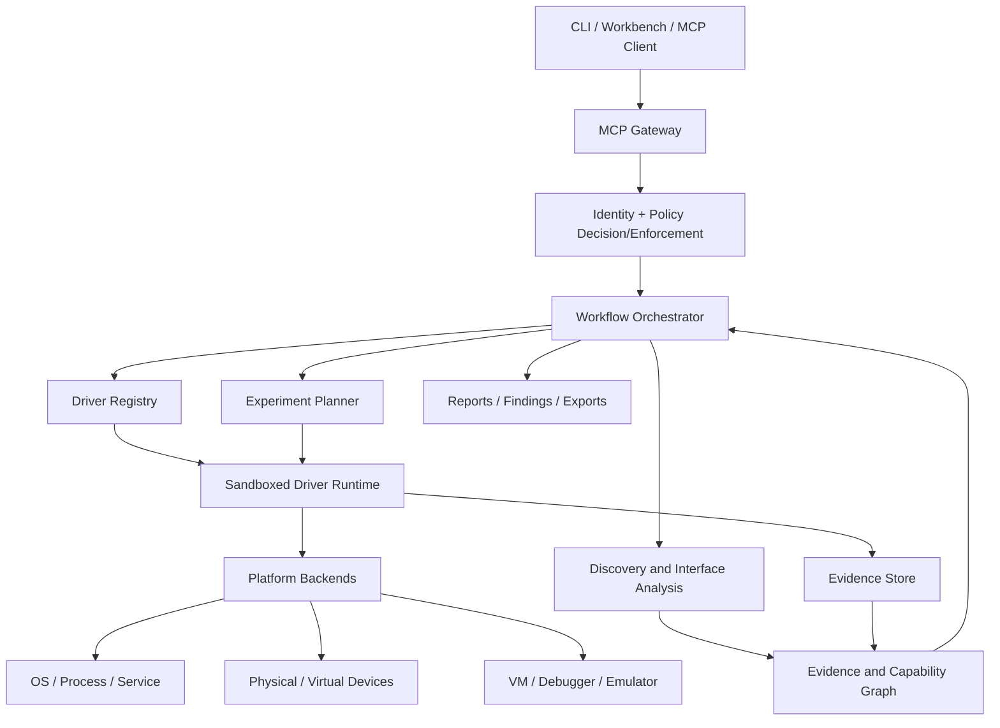
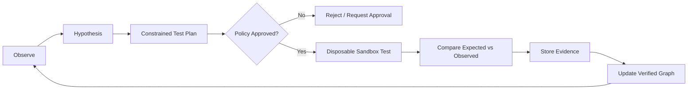
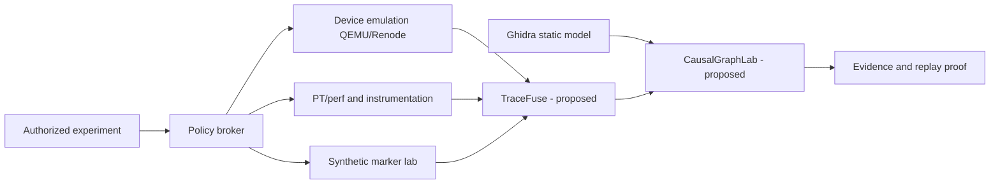

# MCP-AADF — Project Architecture

**Version:** 1.0  
**Status:** Proposed architecture / pre-implementation  
**Scope:** Adaptive application drivers, reverse engineering, security assessment, device emulation, memory intelligence, and reproducible experimentation.

## 1. Executive Summary

MCP-AADF (Model Context Protocol — Adaptive Application Driver Framework) is a modular, evidence-driven platform that discovers software and device interfaces, generates typed adapters, validates them in isolated environments, and exposes approved capabilities through MCP. The same verified application model supports debugging, reverse engineering, QA, digital forensics, security auditing, and controlled adversary emulation.

MCP is the **orchestration interface**, not a kernel driver, privilege grant, exploit primitive, or universal memory-access mechanism. Target-side adapters and OS/hypervisor backends implement real capabilities; a separate policy enforcement point mediates execution.

## 2. Goals and Non-Goals

### Goals

1. Discover CLI, API, GUI, IPC, service, process, device, and documented debugging interfaces.
2. Build provenance-backed capability and trust-boundary graphs.
3. Generate, test, version, and repair typed application adapters.
4. Provide read-only system, process, memory-map, and device inspection.
5. Support authorized lab-only memory modification, virtual device simulation, and fault injection.
6. Compose drivers with least-privilege, per-target capability grants.
7. Produce reproducible experiments, signed evidence manifests, and actionable reports.
8. Integrate reverse-engineering, fuzzing, forensics, and defensive security assessment tools.

### Non-goals

- Universal arbitrary-process or kernel memory read/write.
- Bypassing TEE/enclave protections or confidential-VM boundaries.
- Autonomous exploitation, credential harvesting, stealthy persistence, or lateral movement.
- Running inferred or generated commands without verification.
- Treating an LLM's assertion as evidence.

## 3. Logical Architecture



**Trust boundary:** every call to a driver passes through the policy enforcement point. Graph edges, tool responses, documentation, and model output are untrusted until independently verified.

## 4. Component Specifications

| Component | Responsibilities | Suggested implementation |
|---|---|---|
| MCP Gateway | Tool/resource discovery, schema validation, session routing | Official MCP SDK |
| Identity & Policy | Per-target scope, operation allowlists, approvals, audit | Rust; policy-as-code |
| Orchestrator | Deterministic workflow DAGs, retries, timeouts, rollback | Rust or Python |
| Discovery | Interface enumeration, documentation parsing, environment inventory | Python + platform probes |
| Driver Generator | Typed adapter proposals and test generation | Python + LLM-optional |
| Driver Registry | Versions, signatures, trust status, compatibility | SQLite initially |
| Driver Runtime | Sandboxing, quotas, execution isolation, telemetry | Rust |
| Knowledge Graph | Entities, relations, confidence, evidence provenance | SQLite + NetworkX initially |
| Experiment Engine | Hypothesis, fixture, test, observation, validation | Python |
| Evidence Store | Immutable artifacts, hashes, timestamps, redaction | Content-addressed files |
| Reporting | JSON/SARIF/Markdown findings and reproducibility | Python |

### 4.1 Discovery adapters

- Linux: `/proc`, package metadata, systemd, DBus, ELF, documented CLI help.
- Windows: service manager, ETW, PE metadata, COM, UI Automation, documented process APIs.
- Web/API: OpenAPI, GraphQL schema when authorized, browser accessibility/DOM via Playwright.
- Android (later): ADB-authorized devices, APK static analysis, Binder metadata where exposed.
- Devices: USB descriptors, Bluetooth GATT metadata, serial interfaces, documented management APIs.

### 4.2 Driver lifecycle

`candidate → schema-validated → sandbox-tested → policy-reviewed → registered → monitored → revalidated / revoked`

Any change in binary, target version, permissions, or driver package invalidates affected validation claims. No auto-promotion from generated source to privileged execution.

### 4.3 Capability graph

Nodes: application, executable, process, identity, service, API, IPC endpoint, library, configuration, memory mapping, device, driver, virtual machine, trust boundary, observation.

Edges: `exposes`, `executes_as`, `depends_on`, `reads`, `writes`, `owns`, `maps`, `managed_by`, `communicates_with`, `protected_by`.

Every edge records `source`, `observed_at`, `target_id`, `confidence`, `verification_method`, `artifact_hash`, and `valid_until`. Inferences and verified facts are stored separately.

## 5. Driver Contract

Illustrative application-level schema (not an MCP standard):

```json
{
  "driver_id": "linux.systemd.inspector",
  "version": "0.1.0",
  "target": {"kind": "service", "id": "lab-demo.service"},
  "platforms": ["linux"],
  "operations": [
    {
      "name": "inspect_unit",
      "input_schema": {"type": "object", "properties": {}},
      "effect": "read_only",
      "permission": "service.inspect",
      "approval": "none",
      "evidence_required": true
    }
  ],
  "provenance": {"method": "documented_interface", "verified": true}
}
```

Driver output envelope: `{request_id, target_id, driver_version, status, observations, evidence_refs, errors, duration_ms}`. State-changing operations additionally require an approval reference and rollback plan.

## 6. Security and Authorization Model

**Default deny.** Each operation is checked for operator identity, target scope, driver signature/version, capability, environment, effect category, approval, and expiration.

| Class | Examples | Policy |
|---|---|---|
| Observe | Service metadata, process mappings, device descriptors | Scoped read-only access |
| Diagnose | Debugger attach, dump analysis | Explicit target consent and redaction |
| Modify | Application configuration or memory in a test fixture | Isolated lab + human approval + rollback |
| Emulate | Virtual peripheral, controlled fault injection | Disposable lab environment |
| Prohibited by design | Covert persistence, uncontrolled credential extraction, protected-memory bypass | Not exposed |

Controls: isolated driver processes, filesystem/network restrictions, least privilege, timeouts, rate limits, maximum data sizes, secret redaction, content hashing, append-only audit logs, and emergency stop. Untrusted MCP servers and tool output must not be able to change policy.

## 7. Research Engines

### 7.1 Reverse engineering

Static: Ghidra/Capstone/Tree-sitter, executable metadata, import/export graphs, library dependencies. Dynamic: GDB/LLDB, ETW/eBPF, process events, IPC traces in approved labs. Outputs: behavioral model, API catalog, annotated evidence, compatibility constraints.

### 7.2 Memory intelligence

Enumerate authorized process mappings, heap/stack/library regions, protection flags, and core dumps. Permit bounded reads only where target permissions and policy allow. Writes are restricted to purpose-built disposable debugging fixtures, with before/after evidence and reset. Kernel dump inspection uses separate approved backends. Enclave/TEE analysis is limited to attestation, metadata, and explicit development-debug interfaces; no general protected-content access is assumed.

### 7.3 Device intelligence and emulation

Discover physical devices through documented interfaces; model descriptors, protocols, state transitions, timing, and error behavior. Emulate virtual USB, HID, serial, network, and selected IoT devices through QEMU, Renode, Linux USB gadget, or dedicated simulators. Prevent unsafe physical actuation, firmware damage, and security-token impersonation.

### 7.4 Security assessment

Analyze service permissions, startup registrations, trust boundaries, exposed interfaces, configuration drift, and post-compromise exposure from a predefined authorized identity. Validate candidate findings using non-destructive checks or disposable lab replicas. Persistence-related features focus on detection and benign reversible simulations.

### 7.5 Fuzzing and QA

Integrate libFuzzer/AFL++/libAFL with instrumented test applications. Generate input schemas, seed corpora, crash deduplication, regression tests, and coverage reports. Never fuzz unapproved production targets.

### 7.6 Cloud, mobile, firmware, and supply chain (future)

Cloud: Kubernetes and IAM graph inspection. Mobile: APK/Binder permission analysis. Firmware: UEFI image and measured-boot metadata. Supply chain: SBOM, signatures, build provenance, dependency graphs. Each module requires separate authorization and platform-specific validation.

## 8. Autonomous Experimentation Loop



Each experiment includes a target fingerprint, baseline snapshot, preconditions, allowed operations, resource budget, test oracle, rollback procedure, and evidence manifest. Model-generated hypotheses never directly become execution permissions.

## 9. Inter-Driver Composition

Drivers communicate through the orchestrator, not unrestricted peer-to-peer calls. The orchestrator checks schemas and re-authorizes each delegated capability. Workflows are DAGs with explicit inputs, outputs, timeouts, compensation actions, and failure policies. No privilege inheritance across driver boundaries.

Example authorized workflow: `service inventory → executable metadata → memory-map inspection → graph correlation → audit report`.

## 10. Data and Storage Design

Initial SQLite tables: `targets`, `drivers`, `driver_versions`, `capabilities`, `graph_nodes`, `graph_edges`, `observations`, `evidence`, `experiments`, `approvals`, `audit_events`, `findings`.

Store binary evidence by SHA-256 in a content-addressed directory. Encrypt sensitive evidence at rest where applicable, enforce retention policies, and avoid storing raw secrets. Export JSONL for telemetry, SARIF for findings, Markdown/HTML for reports, and GraphML/JSON for graphs.

## 11. Proposed Repository Layout

```text
mcp-aadf/
├── README.md
├── ARCHITECTURE.md
├── SECURITY.md
├── docs/
│   ├── threat-model.md
│   ├── driver-contract.md
│   ├── policy-model.md
│   └── research-methodology.md
├── crates/
│   ├── mcp-gateway/
│   ├── driver-runtime/
│   ├── policy-engine/
│   └── evidence-core/
├── python/
│   ├── discovery/
│   ├── driver_generation/
│   ├── capability_graph/
│   ├── experiments/
│   └── reporting/
├── drivers/
│   ├── cli/
│   ├── systemd/
│   ├── windows_services/
│   ├── browser/
│   ├── memory_inspector/
│   └── virtual_devices/
├── integrations/
│   ├── ghidra/
│   ├── gdb_lldb/
│   ├── ebpf_etw/
│   ├── qemu_renode/
│   └── fuzzers/
├── schemas/
├── policies/
├── fixtures/
├── tests/
│   ├── unit/
│   ├── integration/
│   ├── adversarial/
│   └── benchmarks/
├── examples/
└── scripts/
```

## 12. Deployment Topologies

**Local research workstation:** MCP client + gateway + policy + SQLite + sandboxed local adapters. Recommended MVP.

**Isolated lab:** Gateway on controller, scoped target-side probes in disposable VMs, snapshot manager, evidence collector. No implicit trust between machines.

**Enterprise read-only assessment:** Centrally managed gateway, authenticated collectors, per-host permissions, approval workflow, encrypted evidence, retention and audit. No default remote execution.

## 13. MVP Vertical Slice

Build only these initially:

1. MCP server with `target.discover`, `driver.inspect`, `driver.validate`, `security.audit`, `evidence.export`.
2. Rust execution boundary with read-only policy and structured audit.
3. Python discovery for CLI programs and systemd test services.
4. Two manually verified drivers and one generated candidate driver.
5. SQLite capability graph and content-addressed evidence store.
6. Disposable Linux VM with snapshot/rollback.
7. CI tests covering tool injection, schema abuse, target-scope violations, and driver failure.

**MVP acceptance:** a previously unintegrated CLI application is discovered, modeled, adapted, sandbox-tested, and used in a read-only workflow; all results link to reproducible evidence. Unauthorized operations are rejected.

## 14. Roadmap and Exit Criteria

| Phase | Focus | Exit criterion |
|---|---|---|
| 0 | Threat model and schemas | Reviewed authorization invariants and contracts |
| 1 | MCP gateway + runtime | Two working read-only drivers |
| 2 | Discovery + generation | One new driver passes automated sandbox tests |
| 3 | Graph + RE integrations | Evidence-linked binary/service relationship model |
| 4 | Security audit + memory | Reproducible findings and safe mapping inspection |
| 5 | Virtual device lab | One protocol simulator passes conformance fixtures |
| 6 | Autonomous experiments | Hypotheses tested with approval and rollback |
| 7 | Extended backends | Platform-specific evaluation and published limitations |

No phase is complete based on a demo alone: require unit, integration, policy, and adversarial tests.

## 15. Metrics and Evaluation

- **Discovery recall:** verified capabilities found / known capabilities.
- **Discovery precision:** verified capabilities found / all proposed capabilities.
- **Driver validation rate:** passing generated drivers / generated drivers.
- **Workflow reliability:** successful authorized workflows / attempted authorized workflows.
- **Policy violation escape rate:** unauthorized test actions executed / unauthorized test actions attempted; target **zero**.
- **False-positive rate:** invalid findings / all reported findings.
- **Maintenance cost:** engineer-hours per target version update.
- **Reproducibility:** independently reproduced experiments / eligible experiments.
- **Overhead:** runtime latency, CPU, memory, and storage versus manual adapters.

Compare generated adapters against hand-written baselines on identical application versions and fixtures. Publish failed cases and confidence intervals where feasible.

## 16. Principal Risks and Mitigations

| Risk | Mitigation |
|---|---|
| Prompt injection in docs/tool output | Treat as data; validate schema and policy independently |
| Hallucinated interfaces | Evidence requirements and sandbox tests |
| Generated code compromise | Isolation, signed artifacts, dependency review |
| Confused deputy across drivers | Re-authorization per delegated operation |
| Sensitive memory exposure | Bounded scope, redaction, retention controls |
| Physical-device damage | Emulators first, hardware interlocks and safe fixtures |
| Enclave overclaims | Explicit capability limits and attestation-only baseline |
| Version drift | Target fingerprints and automatic revalidation |
| Irreversible state changes | Snapshot, approval, rollback, and fail-closed behavior |

## 17. Open Design Decisions

- Rust-only versus Rust/Python hybrid control plane.
- Embedded SQLite graph versus dedicated graph DB at scale.
- Capability-policy language and proof/audit requirements.
- Sandboxing mechanisms by OS and deployment topology.
- Signed driver distribution and revocation protocol.
- Evidence retention and privacy requirements.
- Local versus hosted LLM deployment and data residency.
- Supported MCP protocol/SDK versions (pin and test rather than assume compatibility).

## 18. Foundational References

- Model Context Protocol: https://modelcontextprotocol.io/
- MCP implementations: https://github.com/modelcontextprotocol
- MITRE ATT&CK: https://attack.mitre.org/
- MITRE D3FEND: https://d3fend.mitre.org/
- osquery: https://osquery.io/
- Playwright: https://playwright.dev/
- Ghidra: https://github.com/NationalSecurityAgency/ghidra
- QEMU: https://www.qemu.org/
- Renode: https://renode.io/
- libAFL: https://github.com/AFLplusplus/LibAFL
- OpenTelemetry: https://opentelemetry.io/

---

**Document status:** Architecture proposal. Features described here are planned, not claimed to be implemented or experimentally verified.

## v4: Hardware tracing and future-tool architecture

Intel PT/libipt/perf, DynamoRIO, Ghidra and QEMU/Renode are proposed independent observation/adaptation backends. A policy-controlled experiment scheduler creates bounded workloads, an event-fusion pipeline joins observations with explicit uncertainty, and a provenance graph distinguishes observed, inferred and validated relationships. See [execution intelligence](docs/12-execution-intelligence/INTEL-PT-ARCHITECTURE.md), [integration catalog](docs/13-integrations/INTEGRATION-CATALOG.md), and [future tools](docs/14-future-tools/FUTURE-TOOLS-ATLAS.md).


