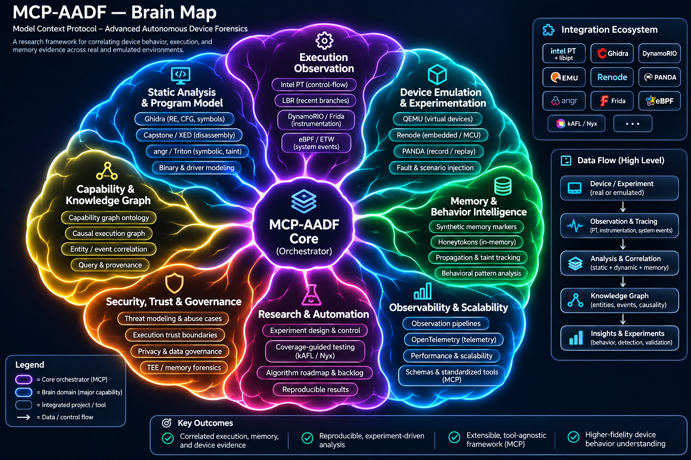

# MCP-AADF v4: execution intelligence and future research

**Status:** architecture and research specifications; no implementation implied.

## New specifications

- [Control Flow Reconstruction](docs/12-execution-intelligence/CONTROL-FLOW-RECONSTRUCTION.md)
- [Cross Platform Observability](docs/12-execution-intelligence/CROSS-PLATFORM-OBSERVABILITY.md)
- [Hardware Trace Backends](docs/12-execution-intelligence/HARDWARE-TRACE-BACKENDS.md)
- [Instrumentation Adapters](docs/12-execution-intelligence/INSTRUMENTATION-ADAPTERS.md)
- [Intel Pt Architecture](docs/12-execution-intelligence/INTEL-PT-ARCHITECTURE.md)
- [Trace Sideband And Symbolization](docs/12-execution-intelligence/TRACE-SIDEBAND-AND-SYMBOLIZATION.md)
- [Ebpf Etw Otel](docs/13-integrations/EBPF-ETW-OTEL.md)
- [Ghidra Static Intelligence](docs/13-integrations/GHIDRA-STATIC-INTELLIGENCE.md)
- [Integration Catalog](docs/13-integrations/INTEGRATION-CATALOG.md)
- [Intel Pt Libipt Perf](docs/13-integrations/INTEL-PT-LIBIPT-PERF.md)
- [Licensing Supply Chain](docs/13-integrations/LICENSING-SUPPLY-CHAIN.md)
- [Qemu Panda Renode](docs/13-integrations/QEMU-PANDA-RENODE.md)
- [Taint Symbolic Fuzzing](docs/13-integrations/TAINT-SYMBOLIC-FUZZING.md)
- [Boundaryoracle](docs/14-future-tools/BOUNDARYORACLE.md)
- [Causalgraphlab](docs/14-future-tools/CAUSALGRAPHLAB.md)
- [Devicechronicle](docs/14-future-tools/DEVICECHRONICLE.md)
- [Driverforge](docs/14-future-tools/DRIVERFORGE.md)
- [Experimentcompiler](docs/14-future-tools/EXPERIMENTCOMPILER.md)
- [Fidelitymeter](docs/14-future-tools/FIDELITYMETER.md)
- [Future Tools Atlas](docs/14-future-tools/FUTURE-TOOLS-ATLAS.md)
- [Memorybeacon](docs/14-future-tools/MEMORYBEACON.md)
- [Protocolcartographer](docs/14-future-tools/PROTOCOLCARTOGRAPHER.md)
- [Provenanceledger](docs/14-future-tools/PROVENANCELEDGER.md)
- [Replayproof](docs/14-future-tools/REPLAYPROOF.md)
- [Tracefuse](docs/14-future-tools/TRACEFUSE.md)
- [Tracegapinspector](docs/14-future-tools/TRACEGAPINSPECTOR.md)
- [Algorithm Research Roadmap](docs/15-algorithms/ALGORITHM-RESEARCH-ROADMAP.md)
- [Causal Inference Validity](docs/15-algorithms/CAUSAL-INFERENCE-VALIDITY.md)
- [Device State Inference](docs/15-algorithms/DEVICE-STATE-INFERENCE.md)
- [Graph Storage Query Planner](docs/15-algorithms/GRAPH-STORAGE-QUERY-PLANNER.md)
- [Benchmark Suite](docs/16-build-plan/BENCHMARK-SUITE.md)
- [Ci Matrix And Release Gates](docs/16-build-plan/CI-MATRIX-AND-RELEASE-GATES.md)
- [Mcp Tools Resources Prompts](docs/16-build-plan/MCP-TOOLS-RESOURCES-PROMPTS.md)
- [Phased Implementation Plan](docs/16-build-plan/PHASED-IMPLEMENTATION-PLAN.md)
- [Reference Scenarios](docs/16-build-plan/REFERENCE-SCENARIOS.md)
- [Rust Workspace And Crates](docs/16-build-plan/RUST-WORKSPACE-AND-CRATES.md)
- [Feasibility And Hardware Matrix](docs/17-governance/FEASIBILITY-AND-HARDWARE-MATRIX.md)
- [Open Research Questions](docs/17-governance/OPEN-RESEARCH-QUESTIONS.md)
- [Prior Art And Novelty](docs/17-governance/PRIOR-ART-AND-NOVELTY.md)
- [Risk Register V4](docs/17-governance/RISK-REGISTER-V4.md)
- [Security And Abuse Prevention](docs/17-governance/SECURITY-AND-ABUSE-PREVENTION.md)

## New examples

- [`causal-edge.json`](examples/causal-edge.json)
- [`device-activity-scenario.yaml`](examples/device-activity-scenario.yaml)
- [`future-tool-registry.json`](examples/future-tool-registry.json)
- [`intel-pt-capability-report.json`](examples/intel-pt-capability-report.json)
- [`marker-experiment.yaml`](examples/marker-experiment.yaml)
- [`normalized-observation.json`](examples/normalized-observation.json)

## Visual architecture

