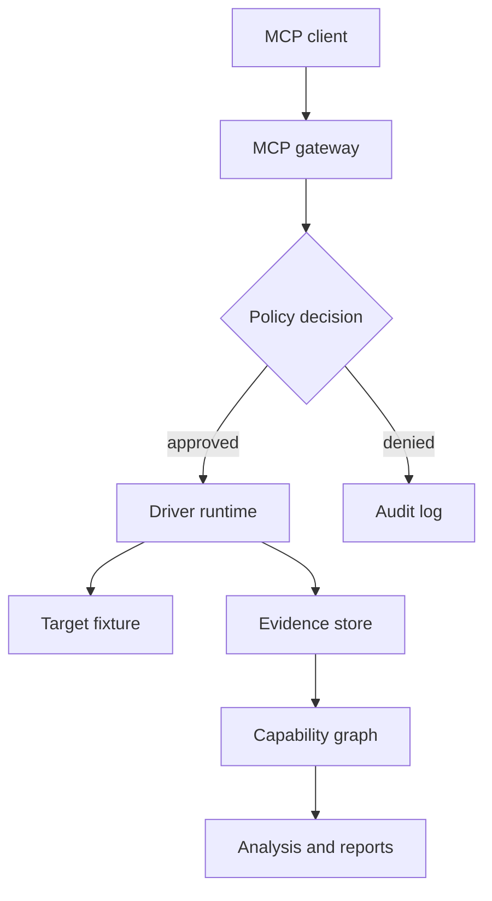

# Component Architecture

> MCP-AADF documentation | Status: proposed design, not validated implementation.

Responsibilities and trust boundaries for each service.

## Core services

MCP gateway: exposes tools and resources. Discovery: gathers metadata. Driver generator: proposes typed adapters. Validator: executes fixture tests. Registry: stores signed metadata. Policy engine: authorizes operations. Runtime: runs sandboxed drivers. Evidence store: immutable references. Graph engine: links verified entities. Reporting: exports results.

## Dependency direction

Client → MCP gateway → policy enforcement → driver runtime → target. Discovery and graph are consumers of evidence. Model reasoning never calls operating-system privileged interfaces directly.

## Failure isolation

Drivers execute in constrained processes; failures are reported with correlation IDs; no implicit retries for state changes.

## Mermaid overview

## Implementation contract

- **Inputs:** Declare typed parameters, target identity, authorization scope and version assumptions.
- **Outputs:** Return structured results, evidence references, confidence and explicit partial-failure states.
- **Isolation:** Use the least-privileged backend, bounded resources and deny-by-default policy.
- **Verification:** Test normal operation, malformed inputs, permission denial, stale target identity, timeouts and cleanup.
- **Acceptance:** Provide reproducible fixtures and measurable success criteria before claiming implementation readiness.

## Open engineering questions

1. Which interfaces can be verified without privileged access?
2. How are version changes detected and cached results invalidated?
3. What telemetry demonstrates correctness and failure?
4. What data must be redacted before reaching a model?
5. What rollback or recovery mechanism applies to state changes?
