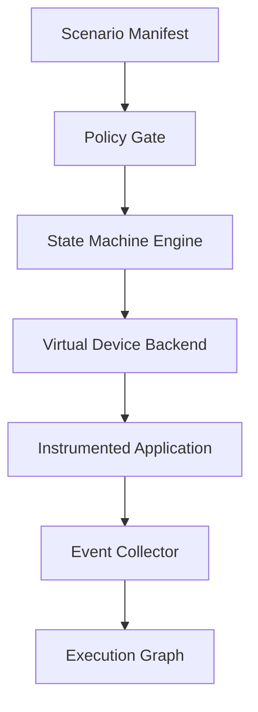

# Device Activity Emulation Engine (DAEE)

## Purpose
Reproduce **device behavior over time**, not just static identifiers. Target virtual USB, serial, HID, BLE sensor simulators, network devices, and virtual disks in owned test environments. Physical devices require explicit scope, safety review and operator approval.

## Architecture

## Scenario contract
- `scenario_id`, `target_id`, `device_type`, `backend`, `seed`, `duration_ms`.
- `events[]`: relative time, input stimulus, expected transition, allowed effects.
- `faults[]`: timeout, disconnect, invalid-but-bounded frame, transient latency.
- `assertions[]`: state, response code, telemetry, safety invariants.
- `rollback`: destroy disposable device, restore snapshot, validate baseline.

## Device models
Represent each device as a Mealy machine `(S, I, O, delta, lambda)` with explicit timeouts and transition guards. Maintain deterministic seeds and record nondeterministic environmental inputs. Start with QEMU virtual serial and Linux USB gadget in a dedicated lab; use Renode for supported embedded platforms.

## Quality measures
Transition coverage, timing deviation, response fidelity, error recovery, reproducibility across runs, false divergence rate, and host resource consumption. A virtual device is a **behavioral approximation**, not proof of full hardware equivalence.

## Acceptance tests
1. Enumerate virtual device with expected descriptors.
2. Replay attach, activity, disconnect, reconnect sequence.
3. Reproduce identical event ordering under a fixed seed.
4. Reject any target not present in authorization manifest.
5. Prove teardown removes virtual interfaces and restores baseline.
